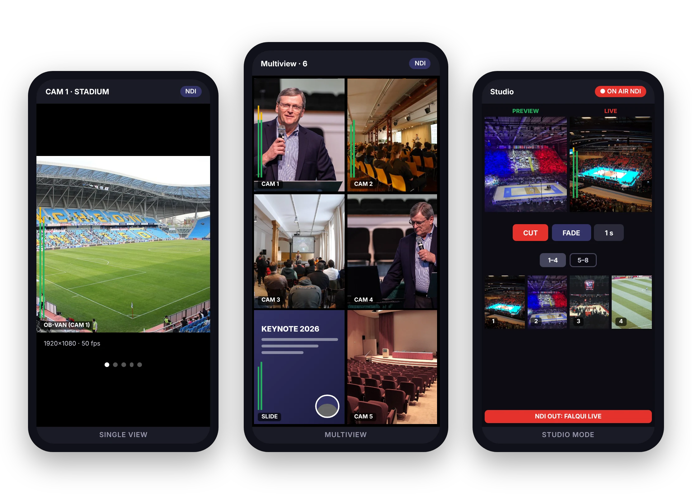

# FALQUI For NDI: download

[Italiano](README.md) · [English](README.en.md) · [Español](README.es.md) · [Français](README.fr.md) · [العربية](README.ar.md) · [中文](README.zh.md)

Download the latest version of **FALQUI For NDI**, the app to watch, listen to and mix the NDI® sources on your network from smartphones and tablets.

[📄 Brochure (PDF)](brochure/FALQUI-For-NDI-2.0-brochure-en.pdf)

| Device | File |
| --- | --- |
| Android, almost all phones (arm64) | [FALQUI-arm64.apk](https://github.com/battacharlie/FALQUI-Download/releases/latest/download/FALQUI-arm64.apk) |
| Android, older devices (armv7) | [FALQUI-armv7.apk](https://github.com/battacharlie/FALQUI-Download/releases/latest/download/FALQUI-armv7.apk) |
| iPhone and iPad (iOS 16+, with Sideloadly) | [FALQUI.ipa](https://github.com/battacharlie/FALQUI-Download/releases/latest/download/FALQUI.ipa) |

## Version 2.0 and an apology for versions 1.x

We apologise to everyone who downloaded the first Android versions (1.x): they often did not work or did not update. The reason was the app's digital signature: each 1.x version was signed with a different key, so Android did not accept it as an update of the one already installed. Versions 1.x have been withdrawn.

From version 2.0 on, every version has the same signature. **If you installed an earlier version, uninstall it once** and then install 2.0: future updates will install over it without problems.

A project by [andreabattaglioli.it](https://www.andreabattaglioli.it/), powered by [mywebtvlive.com](https://www.mywebtvlive.com/). Made in Bolognina.

Use of the app is governed by the Terms of use, which you can read in the app under Credits › Terms.

NDI® is a registered trademark of Vizrt NDI AB. FALQUI For NDI is compatible with NDI but is not an NDI product, nor is it sponsored or endorsed by Vizrt NDI AB. NDI® SDK © 2023-2026 Vizrt NDI AB.
