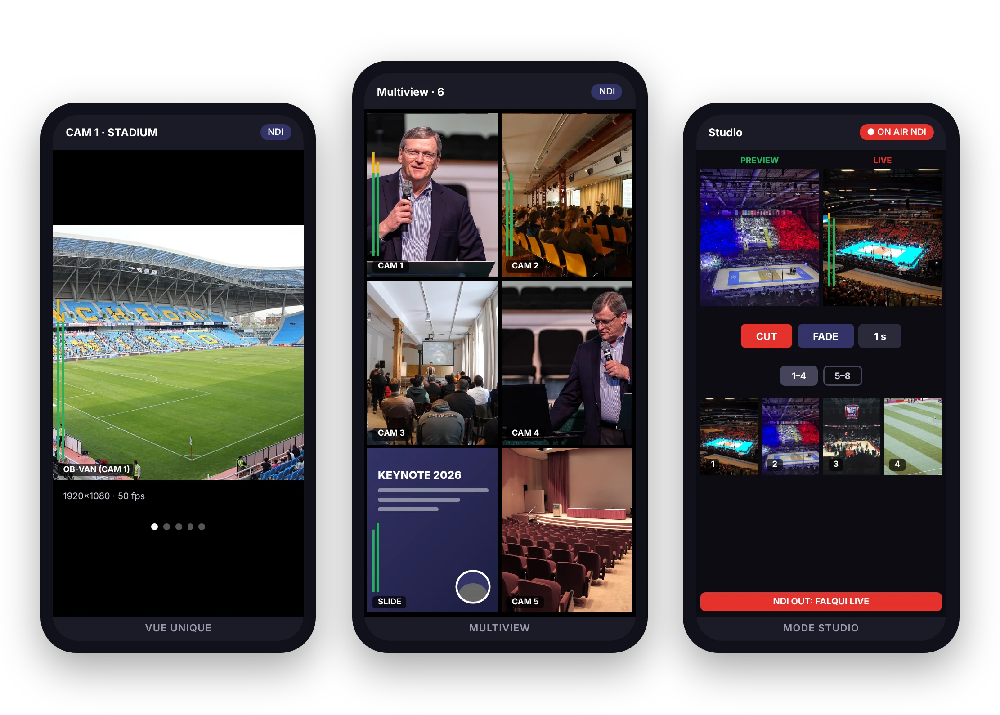

# FALQUI For NDI : téléchargement

[Italiano](README.md) · [English](README.en.md) · [Español](README.es.md) · [Français](README.fr.md) · [العربية](README.ar.md) · [中文](README.zh.md)

Téléchargez ici la dernière version de **FALQUI For NDI**, l'application pour voir, écouter et mixer les sources NDI® du réseau depuis un smartphone, une tablette ou un PC Windows.

[📄 Brochure (PDF)](brochure/FALQUI-For-NDI-2.0-brochure-fr.pdf)

| Appareil | Fichier |
| --- | --- |
| Android, presque tous les téléphones (arm64) | [FALQUI-arm64.apk](https://github.com/battacharlie/FALQUI-Download/releases/latest/download/FALQUI-arm64.apk) |
| Android, appareils anciens (armv7) | [FALQUI-armv7.apk](https://github.com/battacharlie/FALQUI-Download/releases/latest/download/FALQUI-armv7.apk) |
| iPhone et iPad (iOS 16+, avec Sideloadly) | [FALQUI.ipa](https://github.com/battacharlie/FALQUI-Download/releases/latest/download/FALQUI.ipa) |
| Windows 10 et 11 (64 bits), installateur | [FALQUI-Setup.exe](https://github.com/battacharlie/FALQUI-Download/releases/latest/download/FALQUI-Setup.exe) |
| Windows, version portable (sans installation) | [FALQUI-Windows.zip](https://github.com/battacharlie/FALQUI-Download/releases/latest/download/FALQUI-Windows.zip) |

## Version 2.0 et excuses pour les versions 1.x

Nous présentons nos excuses à celles et ceux qui ont téléchargé les premières versions Android (1.x) : elles ne fonctionnaient souvent pas ou ne se mettaient pas à jour. La raison était la signature numérique de l'application : chaque version 1.x était signée avec une clé différente, donc Android ne l'acceptait pas comme mise à jour de celle déjà installée. Les versions 1.x ont été retirées.

Depuis la version 2.0, toutes les versions ont la même signature. **Si vous aviez installé une version précédente, désinstallez-la une fois**, puis installez la 2.0 : les prochaines mises à jour s'installeront par-dessus sans problème.

Un projet de [andreabattaglioli.it](https://www.andreabattaglioli.it/), powered by [mywebtvlive.com](https://www.mywebtvlive.com/). Made in Bolognina.

L'utilisation de l'application est régie par les Conditions d'utilisation, à lire dans l'application sous Credits › Conditions.

NDI® est une marque déposée de Vizrt NDI AB. FALQUI For NDI est compatible avec NDI mais n'est pas un produit NDI, ni sponsorisée ou approuvée par Vizrt NDI AB. NDI® SDK © 2023-2026 Vizrt NDI AB.
